<h1 align="center">Self Improvement Loop</h1>

<p align="center">
  <em>Recursive self-improvement by rejection-sampling self-training with a verifier, built from scratch: a policy that learns to solve reasoning puzzles from its own verified successes, with no human labels.</em>
</p>

<p align="center">
  <a href="https://github.com/adeoluo/self-improvement-loop/actions/workflows/ci.yml"></a>
  
  
  
  
  
</p>

---

## Motivation

A model can improve itself when it can check its own work. Generate candidate solutions,
keep the ones a verifier accepts, train on those, and repeat: the correct traces become the
training set, so the supervision comes from the verifier rather than from human labels. This
is the idea behind self-taught reasoning and rejection-sampling fine-tuning, and it is how
reasoning models bootstrap on tasks with checkable answers.

This project implements that loop from scratch on a small, fully verifiable reasoning task,
with **zero runtime dependencies** and no automatic differentiation. The policy, its softmax
gradient, the verifier, the oracle, and the self-training loop are all written out directly,
so every part of the mechanism is inspectable. The point is not the task; it is the loop that
turns a verifier into a learning signal, and the ablations that show which parts of that loop
actually matter.

## Architecture

<p align="center">
  
</p>

Each iteration samples several rollouts per training puzzle, the **verifier** keeps only the
traces that reach the target, unsolved puzzles are recovered with an oracle **rationalization**
hint, and the policy is updated by **behavior cloning** on the collected state-action pairs.
Greedy accuracy on a held-out split is measured after every iteration. See the
[ADRs](docs/adr/) for the key decisions.

## The task

From a start value, reach a target within a step budget using a fixed action set
(`+1 +2 +3 -1 -2 -3 *2 *3`). Every step is deterministic and every trace can be checked
exactly, which is what makes the task usable for self-training: a trace either lands on the
target or it does not. A breadth-first **oracle** defines solvability and supplies
rationalization hints; the learned policy never calls it during ordinary rollouts.

## The loop

- **Generate** - sample `k` rollouts per puzzle from the current policy at a fixed temperature.
- **Verify and filter** - keep only traces the verifier accepts; for a puzzle solved more than
  once, keep the shortest trace.
- **Rationalize** - for a puzzle no sample solved, roll forward along the oracle's shortest
  solution to recover a correct trace, mirroring the hinted-rollout step of self-taught reasoning.
- **Clone** - take exact softmax-gradient steps that raise the log-probability of the kept
  state-action pairs. The gradient of `log p(a | s)` is the action's feature vector minus its
  expectation under the current policy; it is written out directly, with no autograd.

The policy is **log-linear**: it scores each action with a weight vector over hand-built
features of the state and the action's effect, then forms a softmax over the actions that stay
in bounds. With all weights at zero it is uniform, so an untrained policy solves almost
nothing greedily. Self-training is what concentrates probability onto the actions that solve
puzzles.

## Results

> Reproduce with `python -m self_improvement_loop train`. Primary metric: greedy pass@1 on a
> 120-puzzle held-out split, disjoint from the 200-puzzle training split. A puzzle counts as
> solved only when the verifier accepts the greedy rollout.

| Metric | Untrained | Self-trained |
|---|---:|---:|
| **greedy pass@1 (held out)** | 0.050 | **0.733** |
| sampled pass@1 (temperature 1.0) | - | 0.658 |
| sampled pass@8 | - | 0.900 |
| mean solution length | - | 4.01 steps |
| oracle optimal length | - | 3.16 steps |
| length overhead vs optimum | - | 0.85 steps |

Verifier-filtered self-training lifts greedy accuracy from **0.050 to 0.733**, a roughly
**14x** gain, learning only from its own verified traces. The greedy solutions are close to
the oracle shortest path (0.85 extra steps on average), and sampled **pass@8 reaches 0.900**,
which quantifies the headroom a stronger decoder could still recover.

### Accuracy by iteration

| Iteration | 0 | 1 | 2 | 4 | 6 | 8 | 10 |
|---|---:|---:|---:|---:|---:|---:|---:|
| greedy pass@1 | 0.050 | 0.717 | 0.717 | 0.717 | 0.717 | 0.733 | 0.733 |

Most of the gain arrives in the first iteration because the task is linearly separable in the
chosen features; later iterations refine coverage as sampling, rather than the oracle, comes
to solve almost every training puzzle (hint recoveries fall from 137 to 13).

### Ablations

| Variant | Iteration 1 | Final | Reading |
|---|---:|---:|---|
| Full loop (filter + rationalize) | 0.717 | 0.733 | - |
| No rationalization | 0.675 | 0.775 | hints give a stronger cold start and full coverage; slightly lower asymptote |
| No verifier filtering | 0.033 | 0.550 | training on unfiltered rollouts is unstable and far worse |

The **verifier is the load-bearing component**: cloning every sampled rollout, solved or not,
never exceeds 0.55 and swings erratically, while filtering to verified traces reaches 0.73 and
is stable. **Rationalization** buys a stronger first iteration and guarantees every solvable
puzzle contributes a trace from the start; here its oracle-shortest hints bias slightly toward
multiply-heavy optimal paths, which marginally lowers the greedy asymptote. Full numbers are in
[`docs/EVALUATION_REPORT.md`](docs/EVALUATION_REPORT.md).

## Demonstration

```text
$ python -m self_improvement_loop solve 20 66 --budget 6
Puzzle: 20 -> 66 in <= 6 steps
  actions: *3 +3 +3
  solved:  True

$ python -m self_improvement_loop solve 11 65 --budget 6
Puzzle: 11 -> 65 in <= 6 steps
  actions: *3 *2 -1
  solved:  True
```

The self-trained policy multiplies to close large gaps and then adjusts by small steps to
land exactly on the target, a strategy it learned only from its own verified rollouts.

```text
$ python -m self_improvement_loop train --iterations 10
Self-improvement history (test accuracy by iteration):
  iter  0: acc=0.0500  sampled=  0  hint=  0  examples=   0
  iter  1: acc=0.7167  sampled= 63  hint=137  examples= 754
  ...
  iter 10: acc=0.7333  sampled=187  hint= 13  examples= 755
Final greedy: accuracy=0.7333 (88/120), mean_len=4.01, optimal_len=3.16
pass@8: 0.9000
```

## Quickstart

```bash
git clone https://github.com/adeoluo/self-improvement-loop.git && cd self-improvement-loop
make setup                     # install dev tooling + pre-commit hooks
make all                       # lint + type-check + test

python -m self_improvement_loop train      # run the loop, print accuracy by iteration
python -m self_improvement_loop evaluate   # held-out greedy accuracy and length overhead
python -m self_improvement_loop solve 20 66 --budget 6   # solve one puzzle greedily
python -m self_improvement_loop serve      # start the HTTP service on :8000
```

Inspect the ablations directly:

```bash
python -m self_improvement_loop train --no-rationalize   # drop oracle hints
```

## HTTP service

A standard-library HTTP service trains once at startup, then answers solve and evaluation
requests. The routing logic is a pure function, tested without opening a socket.

| Method | Path | Purpose |
|---|---|---|
| GET | `/health` | liveness and the action set |
| GET | `/ready` | readiness once the policy is trained |
| GET | `/metrics` | per-route request, error, and latency metrics (Prometheus text) |
| POST | `/solve` | body `{"start": int, "target": int, "budget": int?}`; returns a greedy solution and the verifier verdict |
| GET | `/evaluate` | greedy accuracy and solution-length statistics on held-out data |
| GET | `/history` | test accuracy per self-improvement iteration |

```bash
curl -s localhost:8000/solve -d '{"start": 20, "target": 66, "budget": 6}'
curl -s localhost:8000/evaluate
```

Under a concurrent stress benchmark (`uv run python benchmarks/stress.py`, 5000 requests, 8
workers), the `/solve` handler sustains roughly **14,000 requests/second** with **p50 0.07 ms
and p95 0.09 ms** on one CPU, since work per request is bounded by the step budget.

## Design decisions

- **A verifiable task, not a language model** - the loop is the subject, so the task is kept
  small enough that the verifier and oracle are exact and the whole mechanism fits in one
  readable package. See [ADR 0002](docs/adr/0002-verifiable-self-training.md).
- **Log-linear policy with an explicit gradient** - a softmax policy over features has enough
  capacity to show real learning while keeping the behavior-cloning gradient closed-form and
  inspectable, with no autograd. See [ADR 0003](docs/adr/0003-log-linear-policy.md).
- **Rationalization via an oracle** - an exact breadth-first solver supplies hints for puzzles
  the policy cannot yet solve, which is the honest, bounded analogue of a stronger teacher.

## Evaluation

Train and test splits are generated with seeded randomness and filtered to oracle-solvable
puzzles; they are disjoint by construction. All runs are deterministic given a seed. Numbers
above come from the default configuration (200 train, 120 test, 10 iterations, 12 samples per
puzzle, budget 6) on CPU in seconds. Full method and tables:
[`docs/EVALUATION_REPORT.md`](docs/EVALUATION_REPORT.md).

## Responsible AI

- **Model card:** [`docs/MODEL_CARD.md`](docs/MODEL_CARD.md)
- **Data card:** [`docs/DATA_CARD.md`](docs/DATA_CARD.md)
- **Threat model:** [`docs/THREAT_MODEL.md`](docs/THREAT_MODEL.md)

## Limitations

- The task is a small arithmetic reasoning game; it demonstrates the self-training loop, not
  state-of-the-art reasoning. The claims are about the mechanism and its ablations.
- The policy is log-linear over hand-built features. A richer function approximator would raise
  the ceiling but obscure the exact gradient the project exists to show.
- Rationalization relies on an exact oracle, which exists only because the task is small. In a
  real setting the "hint" would come from a stronger model or search, with no correctness
  guarantee.
- Greedy decoding leaves measurable headroom (pass@8 above pass@1); the project does not add a
  search-based decoder.

## Roadmap

- [ ] Add a search-based decoder to close the greedy-to-pass@k gap.
- [ ] Replace the oracle hint with a learned, fallible teacher to study hint quality.
- [ ] Add a difficulty curriculum over the step budget.

## License

[MIT](LICENSE)
